<div align="center">

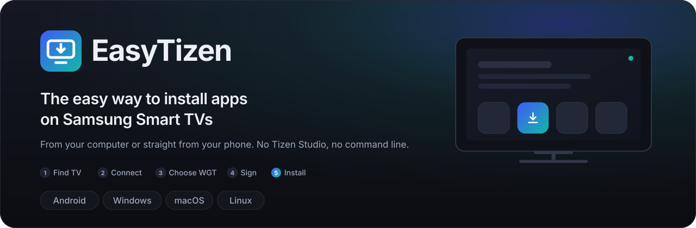

<br><br>

[](https://github.com/volnalabs/TV-Deploy/releases/latest)
[](https://github.com/volnalabs/TV-Deploy/actions/workflows/ci.yml)
[](https://github.com/volnalabs/TV-Deploy/releases)
[](LICENSE)

**[Download](#download)** &nbsp;·&nbsp; [Features](#features) &nbsp;·&nbsp; [Screenshots](#look) &nbsp;·&nbsp; **[Installation](#install)** &nbsp;·&nbsp; [Android](#android) &nbsp;·&nbsp; [Windows](#windows) &nbsp;·&nbsp; [macOS](#macos) &nbsp;·&nbsp; [Linux](#linux) &nbsp;·&nbsp; [Samsung TV](#samsung-tv) &nbsp;·&nbsp; [FAQ](#faq) &nbsp;·&nbsp; [For developers](#dev)

🇷🇺 [Русская версия](README.md)

<br>

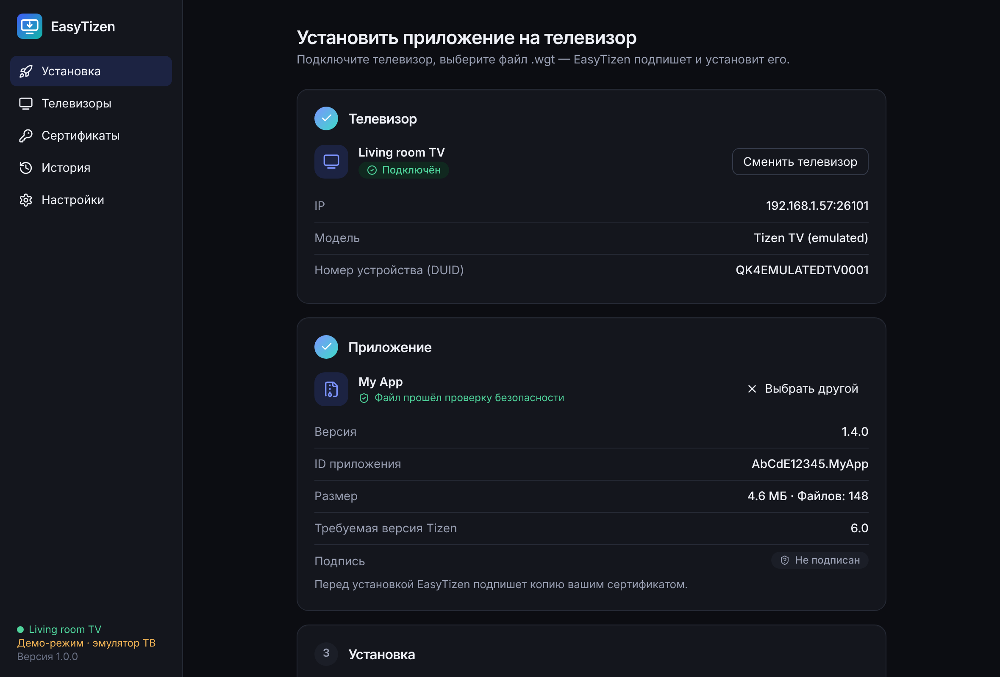

<sub>Three steps on one screen: the TV is connected, the file is checked — press “Install on TV”. (Screenshots show the Russian interface; the app also ships in English.)</sub>

</div>

> [!IMPORTANT]
> **Status: preview 0.9.** Every feature is implemented and covered by automated tests, but installation on a **physical Samsung TV** and operation on a **real Android device** have not yet been confirmed by the author. What was verified and how is listed in the [test report](docs/TEST-REPORT.md); what still needs hands-on verification is in the [checklist](docs/ACCEPTANCE-CHECKLIST.md).

EasyTizen is an independent open-source tool. It ships no TV apps and downloads none for you: you always choose the `.wgt` file yourself.

<p align="center"></p>

<a name="download"></a>

##  Download

<table>
<tr>
<td width="50%"><a href="https://github.com/volnalabs/TV-Deploy/releases/latest/download/EasyTizen-Android.apk"></a></td>
<td width="50%"><a href="https://github.com/volnalabs/TV-Deploy/releases/latest/download/EasyTizen-Windows-x64-Setup.exe"></a></td>
</tr>
<tr>
<td width="50%"><a href="https://github.com/volnalabs/TV-Deploy/releases/latest/download/EasyTizen-macOS-ARM64.dmg"></a></td>
<td width="50%"><a href="https://github.com/volnalabs/TV-Deploy/releases/latest/download/EasyTizen-macOS-Intel.dmg"></a></td>
</tr>
<tr>
<td width="50%"><a href="https://github.com/volnalabs/TV-Deploy/releases/latest/download/EasyTizen-Linux-x64.AppImage"></a></td>
<td width="50%"><a href="https://github.com/volnalabs/TV-Deploy/releases/latest/download/EasyTizen-Linux-x64.deb"></a></td>
</tr>
<tr>
<td colspan="2"><a href="https://github.com/volnalabs/TV-Deploy/releases"></a></td>
</tr>
</table>

The links always point at the latest version. Not sure which one to take? See [Installation](#install). SHA-256 checksums are on every [release](https://github.com/volnalabs/TV-Deploy/releases) page.

<p align="center"></p>

<a name="features"></a>

##  Features

<table>
<tr>
<td width="50%" valign="top">


**Works straight from a phone**<br>
The Android app does everything itself: no computer, no Tizen SDK, no Termux.

</td>
<td width="50%" valign="top">


**Automatic SDK setup**<br>
On desktop it downloads the official Tizen SDK for you: progress, cancel, resume, folder choice.

</td>
</tr>
<tr>
<td width="50%" valign="top">


**Finds TVs on the network**<br>
Discovers TVs with Developer Mode enabled on your home network.

</td>
<td width="50%" valign="top">


**Connect by IP**<br>
Search didn't help? Type the address. On failure it explains why and what to check.

</td>
</tr>
<tr>
<td width="50%" valign="top">


**Reads the DUID**<br>
Fetches the TV's device ID that Samsung needs to issue a certificate.

</td>
<td width="50%" valign="top">


**Creates certificates**<br>
Sign in to your Samsung Account in the browser — the certificate for one or several TVs is ready.

</td>
</tr>
<tr>
<td width="50%" valign="top">


**Imports certificates**<br>
Already have `author.p12` and `distributor.p12` from Tizen Studio? Plug them in.

</td>
<td width="50%" valign="top">


**Safe WGT inspection**<br>
Checks the archive before installing: structure, `config.xml`, zip-bomb and path-traversal protection.

</td>
</tr>
<tr>
<td width="50%" valign="top">


**Signs apps**<br>
Signs a temporary copy with your certificate. Your original file is never changed.

</td>
<td width="50%" valign="top">


**Installs and launches**<br>
Sends the package to the TV, shows each stage and starts the app.

</td>
</tr>
<tr>
<td width="50%" valign="top">


**Several TVs**<br>
Saves devices and their names; one certificate can cover several TVs.

</td>
<td width="50%" valign="top">


**Installation history**<br>
What was installed where and with what result — including the TV's error text.

</td>
</tr>
<tr>
<td width="50%" valign="top">


**Diagnostics**<br>
A report without passwords or keys: copy it or save it to a file for a bug report.

</td>
<td width="50%" valign="top">


**Update check**<br>
Tells you about a new version and links straight to the installer for your system.

</td>
</tr>
</table>

> [!NOTE]
> You need a free Samsung Account (for the certificate) and a Samsung Tizen TV with Developer Mode. No ads, no accounts of our own, no data collection — see [privacy](#privacy).

<p align="center"></p>

<a name="look"></a>

##  Screenshots

### On desktop (Windows, macOS, Linux)

<table>
<tr>
<td width="50%">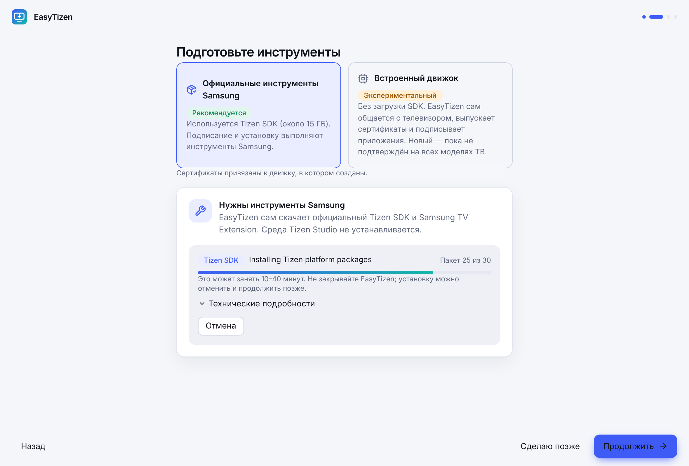<br><sub><b>SDK setup.</b> Choose how to work and install the Samsung tools with progress and cancel</sub></td>
<td width="50%">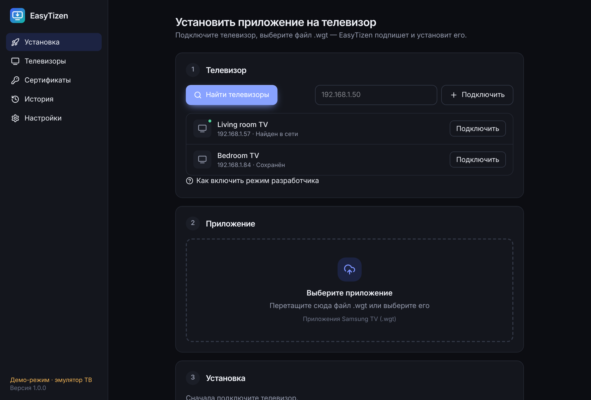<br><sub><b>Connecting the TV.</b> Network search, manual address and saved devices</sub></td>
</tr>
<tr>
<td>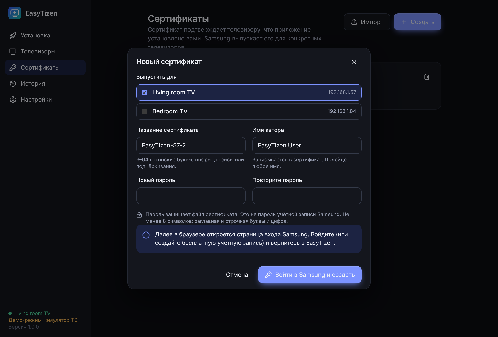<br><sub><b>Certificate.</b> Pick the TVs, choose a password — then sign in to Samsung in the browser</sub></td>
<td><br><sub><b>Choosing a WGT.</b> App details, inspection result and signature state</sub></td>
</tr>
<tr>
<td>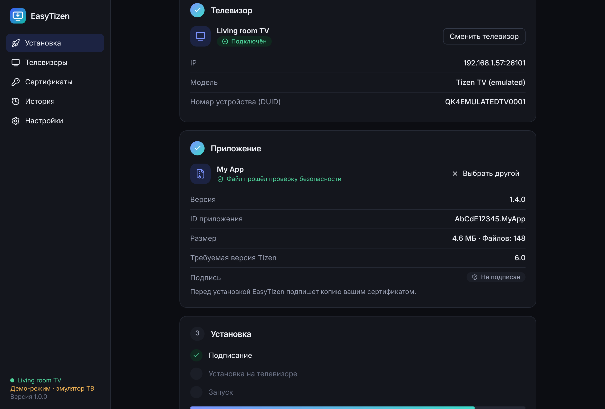<br><sub><b>Installation.</b> Stages: signing, connecting, sending, installing, launching</sub></td>
<td>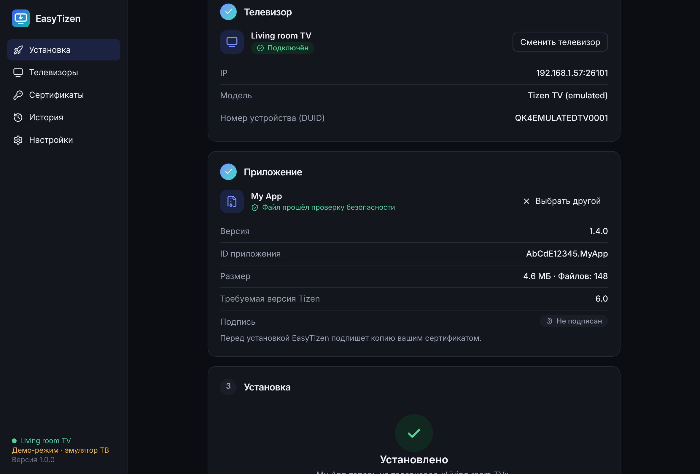<br><sub><b>Done.</b> The app is installed and running on the TV</sub></td>
</tr>
<tr>
<td>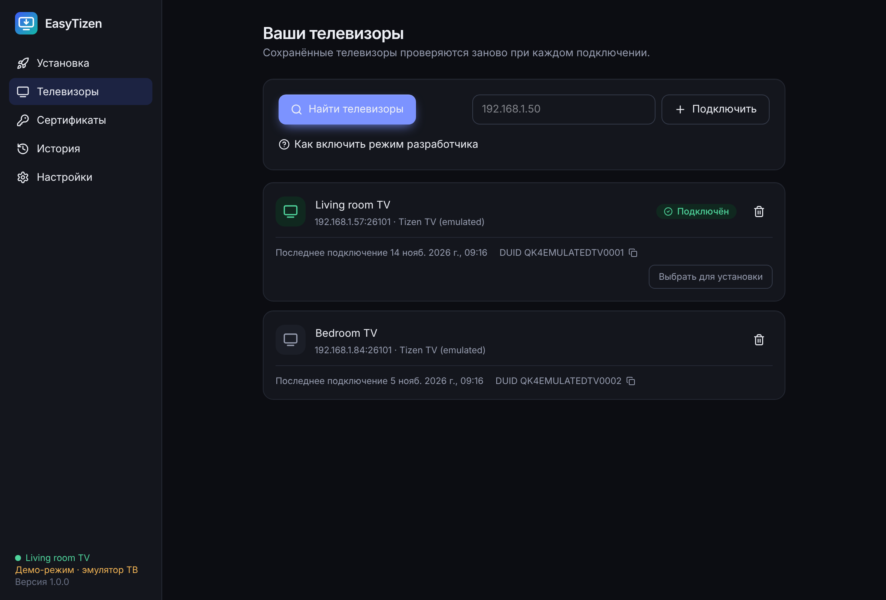<br><sub><b>TVs.</b> Names, addresses, DUIDs and last connection time</sub></td>
<td>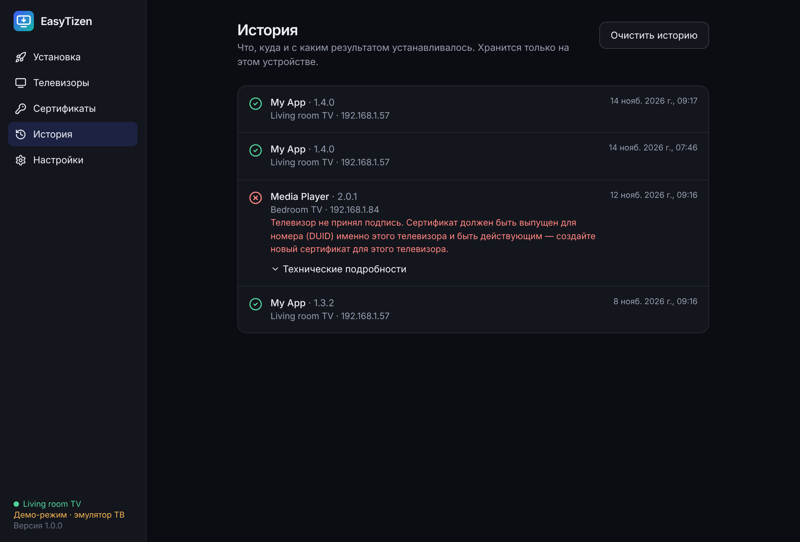<br><sub><b>History.</b> Results with explained errors</sub></td>
</tr>
</table>

### On Android

<table>
<tr>
<td width="25%">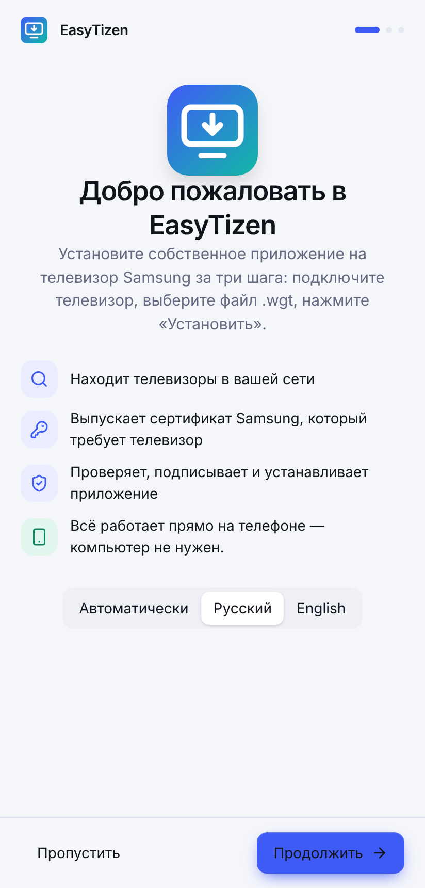<br><sub><b>First launch</b></sub></td>
<td width="25%">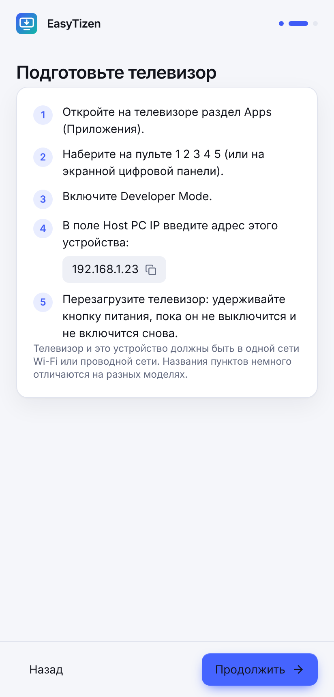<br><sub><b>TV guide</b> with the phone's address</sub></td>
<td width="25%">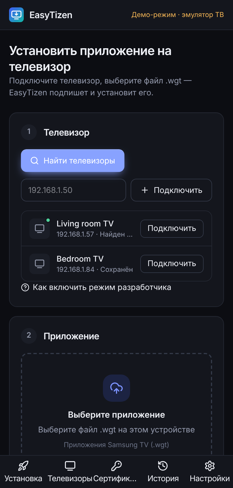<br><sub><b>Finding the TV</b></sub></td>
<td width="25%">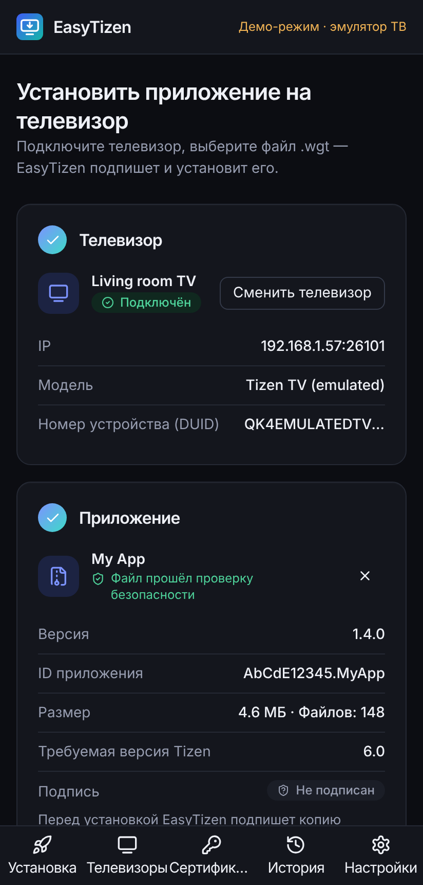<br><sub><b>File checked</b></sub></td>
</tr>
<tr>
<td>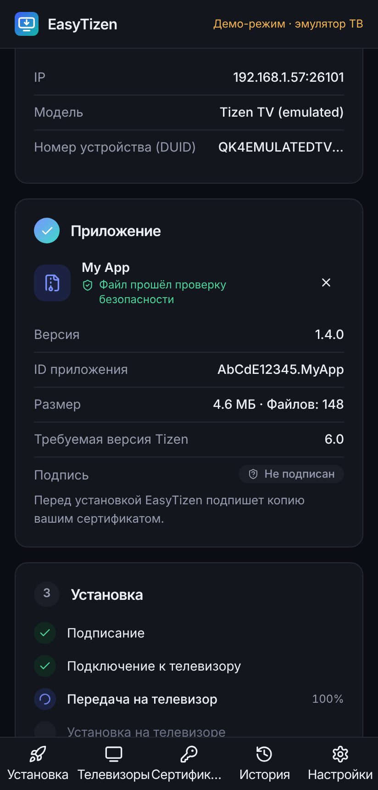<br><sub><b>Progress</b></sub></td>
<td>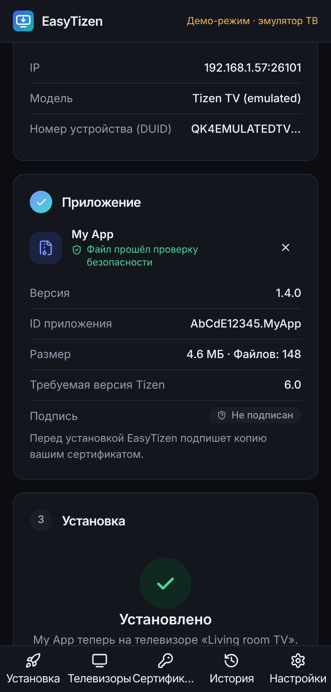<br><sub><b>Installed</b></sub></td>
<td>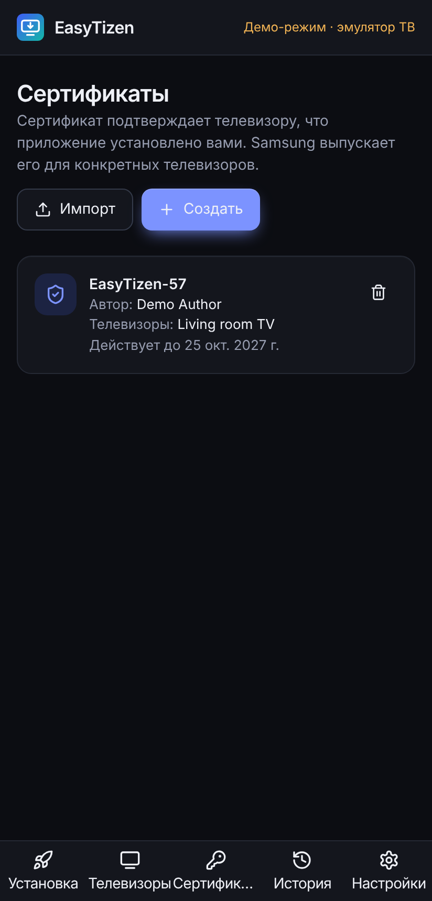<br><sub><b>Certificates</b></sub></td>
<td>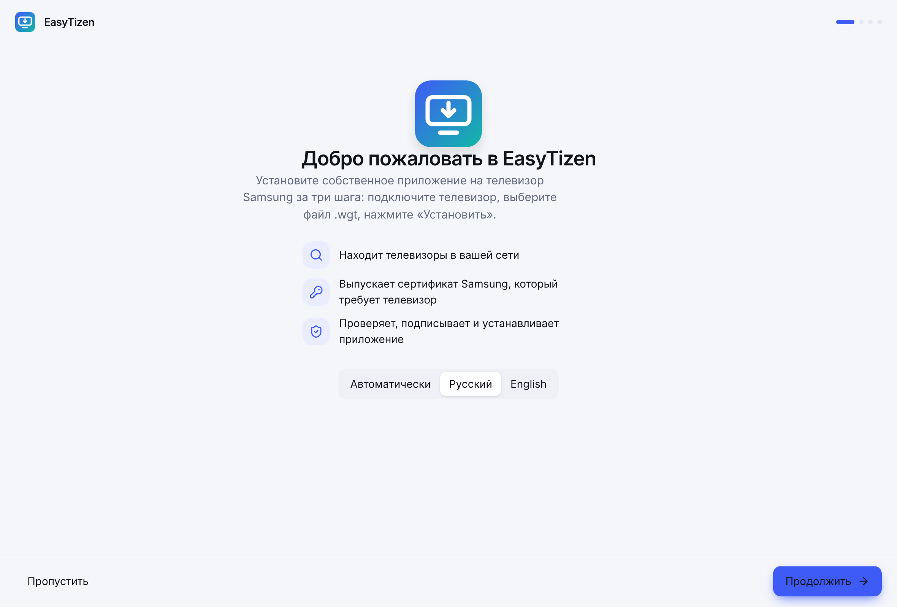<br><sub><b>Light theme</b> (desktop)</sub></td>
</tr>
</table>

<sub>About the screenshots: this is EasyTizen's real interface, captured automatically (<code>scripts/screenshots.mjs</code>) in demo mode — the TV, the certificate and the <i>My App</i> package are emulated, and the “demo mode” label is visible. They were taken in a browser window at desktop-window and phone-screen sizes; the app has not yet been photographed on a real phone and TV. The packaged Linux app running in a test environment: <a href="docs/img/linux-window.png">linux-window.png</a>.</sub>

<p align="center"></p>

<a name="install"></a>

##  Installation

Install EasyTizen on your device first, then prepare the TV and run your first installation.

<table>
<tr>
<td width="50%"><a href="#android"></a></td>
<td width="50%"><a href="#windows"></a></td>
</tr>
<tr>
<td width="50%"><a href="#macos"></a></td>
<td width="50%"><a href="#linux"></a></td>
</tr>
<tr>
<td width="50%"><a href="#samsung-tv"></a></td>
<td width="50%"><a href="#first-install"></a></td>
</tr>
</table>

| | Android | Desktop |
|---|---|---|
| Extra downloads | none | Tizen SDK, about 15 GB (EasyTizen fetches it) — or none with the built-in engine |
| Who signs and installs | EasyTizen's built-in engine | official Samsung tools (default) or the built-in engine |
| Samsung Account | needed for the certificate | needed for the certificate |

<a name="android"></a>

###  Android

A phone or tablet with Android 7.0 or newer. No computer needed.

1. Download [`EasyTizen-Android.apk`](https://github.com/volnalabs/TV-Deploy/releases/latest/download/EasyTizen-Android.apk) on the phone.
2. Open the file. If Android asks about “unknown sources”, allow installation for the browser or file manager you open it from.
3. Start EasyTizen and go through the welcome guide. The phone must be on the same Wi-Fi network as the TV (not mobile data, not a guest network).

| Permission | Why |
|---|---|
| Network access | talking to the TV on the local network and to Samsung's certificate service |
| Network and Wi-Fi state | knowing the phone is online before searching for TVs |

No other permissions are requested: the `.wgt` file is picked through the system document picker.

> [!WARNING]
> If an APK was built without the project's permanent key (the release notes say so), a new version cannot be installed over the old one: Android asks you to uninstall first. Uninstalling removes the app's certificates — create them again or import your `.p12` files.

<sub><a href="#install">↑ back to devices</a></sub>

<a name="windows"></a>

###  Windows

Windows 10 and 11, 64-bit.

1. Download [`EasyTizen-Windows-x64-Setup.exe`](https://github.com/volnalabs/TV-Deploy/releases/latest/download/EasyTizen-Windows-x64-Setup.exe) and run it.
2. It installs for the current user; administrator rights are not required.
3. On the first TV connection Windows may ask about network access — allow it for private networks.

> [!NOTE]
> Until the installer is signed with a publisher certificate, SmartScreen shows “Windows protected your PC”. Click **More info → Run anyway**. Whether a particular release is signed is stated in its release notes.

<sub><a href="#install">↑ back to devices</a></sub>

<a name="macos"></a>

###  macOS

macOS 10.15 or newer.

1. Download the file for your processor (Apple menu → About This Mac): [Apple M1 and newer](https://github.com/volnalabs/TV-Deploy/releases/latest/download/EasyTizen-macOS-ARM64.dmg) or [Intel](https://github.com/volnalabs/TV-Deploy/releases/latest/download/EasyTizen-macOS-Intel.dmg).
2. Open the `.dmg` and drag EasyTizen to Applications.
3. **First launch.** Until the app is notarized by Apple, macOS blocks it. Open **System Settings → Privacy & Security**, scroll down and click **Open Anyway** next to the EasyTizen message.

If macOS says the app is damaged, run in Terminal:

```sh
xattr -cr /Applications/EasyTizen.app
```

> [!IMPORTANT]
> For the “Official Samsung tools” mode the Tizen SDK installer needs Bash 4 or newer, while macOS ships Bash 3.2. Install a current one: `brew install bash`. The built-in engine does not need Bash.

<sub><a href="#install">↑ back to devices</a></sub>

<a name="linux"></a>

###  Linux

64-bit, with WebKitGTK 4.1 (Ubuntu 22.04+, Debian 12, Fedora 38+).

**AppImage — any distribution:**

```sh
chmod +x EasyTizen-Linux-x64.AppImage
./EasyTizen-Linux-x64.AppImage
```

If it does not start on Ubuntu 22.04 or newer, install `libfuse2`: `sudo apt install libfuse2`.

**DEB — Debian, Ubuntu, Mint:**

```sh
sudo apt install ./EasyTizen-Linux-x64.deb
```

EasyTizen then appears in the applications menu. To remove it: `sudo apt remove easy-tizen`.

<sub><a href="#install">↑ back to devices</a></sub>

<a name="samsung-tv"></a>

###  Samsung TV: Developer Mode

Samsung TVs do not install apps from a USB stick. An app that is not in the store is installed over the network through Developer Mode.

####  Find the address of the device running EasyTizen

EasyTizen shows it: in the welcome guide and behind the **“How to enable Developer Mode”** link in the “Your TV” block. It looks like `192.168.1.23` — the TV will trust this address.

####  Turn Developer Mode on

1. Open **Apps** on the TV.
2. Press **1 2 3 4 5** on the remote. No number keys? Press **123** and enter them on screen.
3. Switch **Developer Mode** on.
4. Enter the address from step 1 as **Host PC IP**.
5. Press OK.

####  Restart the TV

Hold the power button on the remote until the TV turns off and on again. Apps will show a **Develop mode** label.

> [!TIP]
> The TV's own address (if search cannot find it): **Settings → General → Network → Network Status → IP Settings**.

<details>
<summary><b>If the TV does not connect</b></summary>

<br>

| What happens | What to check |
|---|---|
| Search does not find the TV | TV is on · Developer Mode is on · both devices are on the same, non-guest network · try entering the address |
| “The TV is there, but it refuses developer connections” | Host PC IP is the address of this very device · the TV was restarted after the change |
| It worked before, not now | The phone's or computer's address changed — enter the new one as Host PC IP and restart the TV |
| Host PC IP is saved backwards | Some firmwares with right-to-left languages need the address entered in reverse |
| Firewall | Allow EasyTizen outgoing connections to port `26101` |

</details>

<sub><a href="#install">↑ back to devices</a></sub>

<a name="first-install"></a>

###  Your first installation

####  Prepare the tools (desktop only)

On first launch choose how EasyTizen should work:

| | Official Samsung tools | Built-in engine |
|---|---|---|
| Download | Tizen SDK and Samsung TV Extension, about 15 GB | nothing |
| Setup time | 10–40 minutes | immediate |
| Status | recommended | experimental |

For the official tools click **“Install automatically”**: EasyTizen shows the folder and free space, per-package progress, and lets you cancel and resume later. Already have Tizen Studio? Click **“Use an existing SDK”**.

There is no such step on Android.

####  Connect the TV

Click **“Find TVs”** or type the address and click **“Connect”**. EasyTizen then shows the model and device ID (DUID) and remembers the TV.

####  Choose the `.wgt` file

Drop the file onto the window or click **“Choose file”**. EasyTizen inspects the archive and shows the name, version, app ID and signature state.

####  Create a certificate

Done once per TV.

1. In the “Install” step click **“Create certificate”**.
2. Tick the TVs it is for, choose a name and a password (at least 8 characters with an uppercase letter, a lowercase letter and a digit). This is the certificate file's password, not your Samsung Account password.
3. Click **“Sign in with Samsung and create”** — Samsung's sign-in page opens in the browser. Sign in or create a free account, then return to EasyTizen.

> [!NOTE]
> Already have a certificate pair from Tizen Studio? Click **“Import existing”** and choose `author.p12`, `distributor.p12` and their passwords. The distributor certificate must have been issued for your TV's DUID.

####  Install

Click **“Install on TV”**. EasyTizen signs a copy of the file, sends it and shows every stage. The app appears under Apps on the TV and, with “Launch after installation” on, opens right away.

<details>
<summary><b>If installation fails</b></summary>

<br>

| Message | What to do |
|---|---|
| The TV rejected the signature | The certificate was issued for another TV or has expired. Create a new certificate for this TV |
| Signed by a different author | The app is already on the TV with someone else's signature. Remove it from the TV (built-in engine: the “Remove the old copy…” button) and retry |
| Not enough space on the TV | Remove unused apps on the TV |
| The TV stopped answering | Check the network and that the TV did not go to standby, then retry |
| The TV did not confirm the installation | Look under Apps; open “Technical details” and attach them to a bug report |

The TV's full answer is under the error in “Technical details” and in History.

</details>

<sub><a href="#install">↑ back to devices</a></sub>

<p align="center"></p>

<a name="faq"></a>

##  FAQ

<details>
<summary><b>Which TVs are supported?</b></summary>

<br>

Samsung TVs running Tizen with Developer Mode — roughly 2016 models and newer. Samsung TVs on other systems (Orsay, before 2015) and other brands are not supported. The list of models verified with EasyTizen will appear in the [test report](docs/TEST-REPORT.md) — it is empty for now.

</details>

<details>
<summary><b>How do I enable Developer Mode?</b></summary>

<br>

Apps → press **1 2 3 4 5** on the remote → switch Developer Mode on → enter the address of the device running EasyTizen as Host PC IP → restart the TV. Details are in [Samsung TV](#samsung-tv); the app shows the same guide with your address filled in.

</details>

<details>
<summary><b>Why is my TV not found?</b></summary>

<br>

Search probes the addresses of your subnet (`192.168.x.1–254`) for the open developer port `26101`. A TV is not found when Developer Mode is off, the TV is in deep standby, the devices are on different networks (guest Wi-Fi, client isolation, VPN) or the network is larger than one /24 subnet. In those cases enter the TV's address manually.

</details>

<details>
<summary><b>Why is Host PC IP needed?</b></summary>

<br>

The TV accepts developer connections from a single address — the one you entered in the Developer Mode window. That is its protection: other devices on the network cannot install anything. So when your phone's or computer's address changes, update Host PC IP and restart the TV.

</details>

<details>
<summary><b>What is a DUID?</b></summary>

<br>

Device Unique ID — the TV's unique number. Samsung writes it into the distributor certificate, and a TV accepts only packages whose certificate lists its number. EasyTizen reads the DUID when it connects.

</details>

<details>
<summary><b>Why are certificates needed?</b></summary>

<br>

Tizen installs signed apps only. Two certificates are required: an **author** certificate (who built the package) and a **distributor** certificate (which TVs may run it). Samsung issues both for free for your account. Private keys are generated on your device and never leave it.

</details>

<details>
<summary><b>Why is a certificate tied to a TV?</b></summary>

<br>

That is how Samsung limits installation of apps from outside the store: a distributor certificate is valid only on TVs whose DUIDs it lists. For a new TV create a new certificate — or tick several TVs when creating one.

</details>

<details>
<summary><b>Which WGT files can be installed?</b></summary>

<br>

Tizen web apps in `.wgt` format (a ZIP archive with `config.xml`) up to 512 MB. Signed or not does not matter: EasyTizen signs a copy with your certificate. `.tpk` and apps for other platforms are not supported. Whether an app runs depends on your TV's Tizen version — the required version is shown in the file details.

</details>

<details>
<summary><b>Why did installation fail?</b></summary>

<br>

Most often because of the certificate (issued for another TV, or expired), a conflict with a copy already installed by another author, or a lost connection. EasyTizen states the reason in plain language and keeps the TV's full answer under “Technical details”. See the table in [Your first installation](#first-install).

</details>

<details>
<summary><b>Can I install apps straight from Android?</b></summary>

<br>

Yes — the Android version is a standalone installer: it speaks SDB to the TV itself, issues certificates and signs packages. One important caveat: so far it has been verified by automated tests and a successful build, not on a real phone with a real TV — see [known limitations](docs/KNOWN-LIMITATIONS.md).

</details>

<details>
<summary><b>Do I need a computer?</b></summary>

<br>

Not if you have Android. The Windows, macOS and Linux versions are an alternative for those who prefer a computer or want Samsung's official tools to do the work.

</details>

<details>
<summary><b>Where are certificates stored?</b></summary>

<br>

- **Built-in engine:** in the app data folder, `certificates/<name>/author.p12` and `distributor.p12`, encrypted with your password. The password is not saved — EasyTizen remembers it until you close the app and asks again after a restart.
- **Official Samsung tools:** in the Tizen SDK keystore (`<SDK folder>-data/keystore/samsung/<name>/`); the password is kept by the operating system's secure storage — that is how Samsung's tools work.

App data folder: Windows — `%APPDATA%\io.github.volnalabs.easytizen`, macOS — `~/Library/Application Support/io.github.volnalabs.easytizen`, Linux — `~/.local/share/io.github.volnalabs.easytizen`, Android — the app's internal storage, inaccessible to other apps.

</details>

<details>
<summary><b>How does EasyTizen update?</b></summary>

<br>

At start-up the app asks GitHub for the latest version number and, if it is newer, shows a bar linking to the installer for your system. You start the download and installation yourself — there is no silent auto-update. The check can be turned off in Settings, where a “Check now” button also lives.

</details>

<details>
<summary><b>How do I diagnose problems?</b></summary>

<br>

**Settings → Diagnostics → “Copy report”** (or “Save to file”). The report lists the version, system, tool status, saved TVs, certificates and recent installations with errors. It contains no passwords, keys or tokens, and device IDs are shortened. Attach it to a [bug report](https://github.com/volnalabs/TV-Deploy/issues).

</details>

<details>
<summary><b>I used TV Deploy. What about my data?</b></summary>

<br>

EasyTizen is TV Deploy's new name. On first launch it migrates your settings, saved TVs and certificate profiles. The Tizen SDK and its certificates stay where they are. The old TV Deploy app can be uninstalled.

</details>

<p align="center"></p>

<a name="dev"></a>

##  For developers

<details>
<summary><b>Architecture, layout, tests and builds</b></summary>

<br>

```
React/TS interface ──typed commands──▶ src-tauri (Rust) ──▶ easytizen-core
                                            │
                  ┌─────────────────────────┴─────────────────────────────┐
           SDK engine (desktop)                              Built-in engine (everywhere)
     Node.js + Samsung CLI + Tizen SDK                 own SDB client, WGT signer and
          sdb · tz · cert-manager                        Samsung CA certificate flow
```

```
crates/easytizen-core/   UI-independent core: WGT inspection, SDB client, signing, Samsung CA,
                         diagnostics, TV emulator for tests
src-tauri/               Tauri 2 shell: commands, both engines, settings, history
src-tauri/gen/android/   Android project (Gradle)
src/                     interface (React, TypeScript, Tailwind), browser demo backend
resources/samsung-cli/   pinned copy of Samsung tizen-sdk-skills (Apache-2.0)
scripts/                 Node.js download, release checks, README artwork generator
docs/                    documentation, screenshots, README artwork
```

You need Node.js 22 and Rust stable; for desktop the [Tauri prerequisites](https://v2.tauri.app/start/prerequisites/), for Android JDK 21, Android SDK (platform 36, build-tools 35) and NDK 27.

```sh
npm ci

# Tests
cargo test --workspace --features easytizen-core/mock-tv   # Rust: core and backend
npm test                                                   # interface and release scripts
npm run typecheck

# Interface in a browser with an emulated TV (no Rust needed)
npm run dev            # http://localhost:1420 · ?platform=android · ?demo=fresh

# TV emulator for the built-in engine
cargo run -p easytizen-core --example mock_tv --features mock-tv -- 0.0.0.0 26101

# Desktop
node scripts/fetch-node.mjs linux-x64     # win-x64 | darwin-arm64 | darwin-x64
npx tauri dev
npx tauri build --bundles appimage,deb    # nsis | dmg

# Android
export ANDROID_HOME=… NDK_HOME=$ANDROID_HOME/ndk/27.2.12479018
npx tauri android build --apk --target aarch64 armv7
```

More: [architecture](docs/ARCHITECTURE.md) · [test report](docs/TEST-REPORT.md) · [known limitations](docs/KNOWN-LIMITATIONS.md) · [releasing and signing](docs/RELEASING.md) · [dependencies](docs/DEPENDENCIES.md) · [changelog](CHANGELOG.md).

</details>

<a name="privacy"></a>
<a name="license"></a>

##  License and privacy

**License.** [Apache-2.0](LICENSE). EasyTizen is an independent project; it is not affiliated with or endorsed by Samsung. Samsung and Tizen are trademarks of their owners.

**Third-party components**

| Component | Used in | License |
|---|---|---|
| [Samsung tizen-sdk-skills](https://github.com/Samsung/tizen-agent-skills) (CLI and Samsung VD CA certificates) | desktop builds; the CA certificates everywhere | Apache-2.0, see [`LICENSE`](resources/samsung-cli/LICENSE) and [`NOTICE`](resources/samsung-cli/NOTICE) |
| [Node.js](https://nodejs.org/) 22 | desktop builds (runs the Samsung CLI) | MIT |
| [Tauri](https://tauri.app/) 2 with the dialog, fs and opener plugins | application shell | MIT / Apache-2.0 |
| [React](https://react.dev/), [lucide](https://lucide.dev/), [Tailwind CSS](https://tailwindcss.com/) | interface | MIT / ISC |
| RustCrypto (`rsa`, `sha2`, `x509-cert`), `p12-keystore`, `ureq`, `rustls`, `zip`, `roxmltree` | core | MIT / Apache-2.0 |

The Tizen SDK is not bundled: with the official tools selected, Samsung's installer downloads it from the Tizen servers under Samsung's terms. Full list: [docs/DEPENDENCIES.md](docs/DEPENDENCIES.md).

**What is stored on your device.** Settings, the TV list (address, name, DUID), certificate metadata and the installation history — in the app data folder. Certificates — as encrypted `.p12` files. EasyTizen never writes certificate passwords or the Samsung token to disk. With the official tools selected, Samsung's own tooling keeps the certificate password in the operating system's secure storage.

**Where the app connects**

| Address | When | What is sent |
|---|---|---|
| Your TV, port `26101`, local network | search, connection, installation | SDB commands and your package |
| Addresses of your subnet, port `26101` | only when you press “Find TVs” | a TCP connection attempt |
| `account.samsung.com` (in your browser) | creating a certificate | you sign in yourself on Samsung's site |
| `svdca.samsungqbe.com` | creating a certificate | the certificate request (public key, author name, DUID) and the Samsung token |
| `api.github.com` | update check (can be disabled) | nothing beyond a standard request |
| `download.tizen.org` and mirrors | Tizen SDK installation (desktop) | performed by Samsung's installer |

EasyTizen has no servers of its own, no analytics and no telemetry.
