<div align="center">

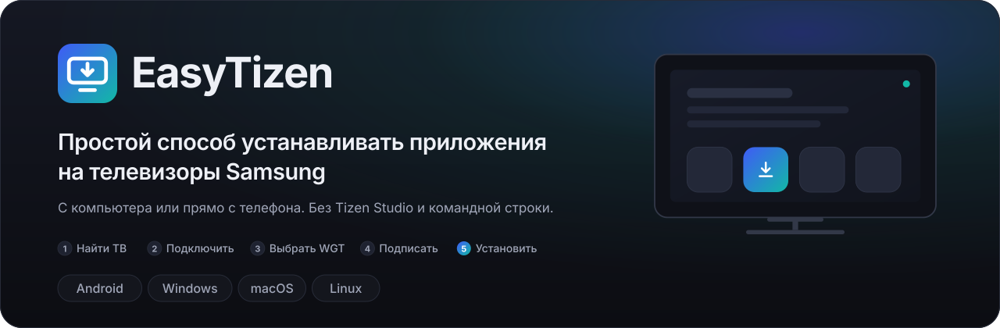

<br><br>

[](https://github.com/volnalabs/TV-Deploy/releases/latest)
[](https://github.com/volnalabs/TV-Deploy/actions/workflows/ci.yml)
[](https://github.com/volnalabs/TV-Deploy/releases)
[](LICENSE)

**[Скачать](#download)** &nbsp;·&nbsp; [Возможности](#features) &nbsp;·&nbsp; [Как выглядит](#look) &nbsp;·&nbsp; **[Установка](#install)** &nbsp;·&nbsp; [Android](#android) &nbsp;·&nbsp; [Windows](#windows) &nbsp;·&nbsp; [macOS](#macos) &nbsp;·&nbsp; [Linux](#linux) &nbsp;·&nbsp; [Samsung TV](#samsung-tv) &nbsp;·&nbsp; [FAQ](#faq) &nbsp;·&nbsp; [Для разработчиков](#dev)

🇬🇧 [English version](README.en.md)

<br>

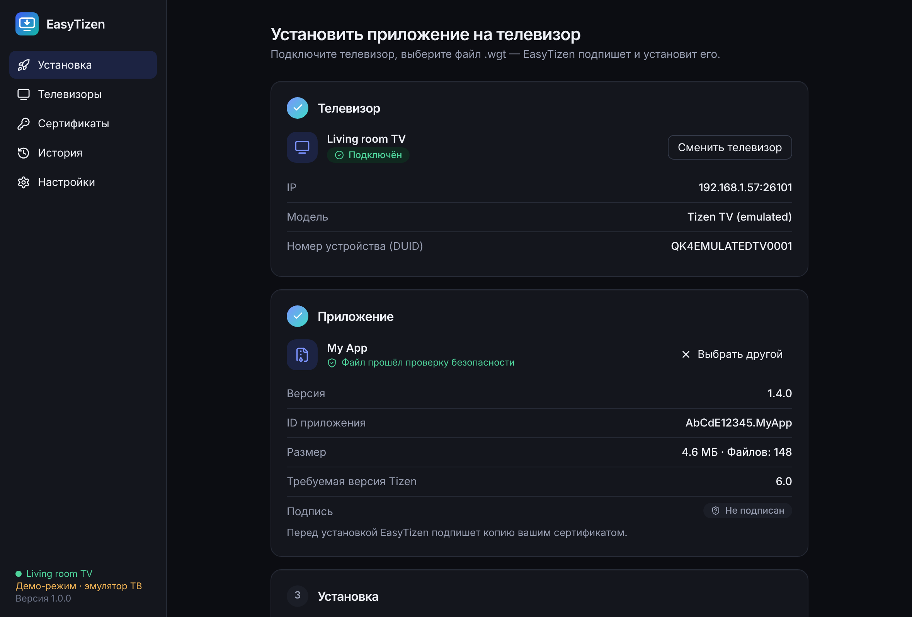

<sub>Три шага на одном экране: телевизор подключён, файл проверен — остаётся нажать «Установить на телевизор».</sub>

</div>

> [!IMPORTANT]
> **Статус: предварительная версия 0.9.** Все функции реализованы и покрыты автоматическими тестами, но установка на **физический телевизор Samsung** и запуск на **реальном Android-устройстве** ещё не подтверждены автором. Что именно проверено и чем — в [отчёте о тестировании](docs/TEST-REPORT.md); что предстоит проверить руками — в [чек-листе](docs/ACCEPTANCE-CHECKLIST.md).

EasyTizen — самостоятельный инструмент с открытым исходным кодом. Он не содержит приложений для телевизора и ничего не скачивает за вас: файл `.wgt` для установки вы выбираете сами.

<p align="center"></p>

<a name="download"></a>

##  Скачать

<table>
<tr>
<td width="50%"><a href="https://github.com/volnalabs/TV-Deploy/releases/latest/download/EasyTizen-Android.apk"></a></td>
<td width="50%"><a href="https://github.com/volnalabs/TV-Deploy/releases/latest/download/EasyTizen-Windows-x64-Setup.exe"></a></td>
</tr>
<tr>
<td width="50%"><a href="https://github.com/volnalabs/TV-Deploy/releases/latest/download/EasyTizen-macOS-ARM64.dmg"></a></td>
<td width="50%"><a href="https://github.com/volnalabs/TV-Deploy/releases/latest/download/EasyTizen-macOS-Intel.dmg"></a></td>
</tr>
<tr>
<td width="50%"><a href="https://github.com/volnalabs/TV-Deploy/releases/latest/download/EasyTizen-Linux-x64.AppImage"></a></td>
<td width="50%"><a href="https://github.com/volnalabs/TV-Deploy/releases/latest/download/EasyTizen-Linux-x64.deb"></a></td>
</tr>
<tr>
<td colspan="2"><a href="https://github.com/volnalabs/TV-Deploy/releases"></a></td>
</tr>
</table>

Ссылки всегда ведут на свежую версию. Не знаете, что выбрать, — смотрите [установку](#install). Контрольные суммы SHA-256 есть на странице каждого [релиза](https://github.com/volnalabs/TV-Deploy/releases).

<p align="center"></p>

<a name="features"></a>

##  Возможности

<table>
<tr>
<td width="50%" valign="top">


**Работает прямо с телефона**<br>
Версия для Android делает всё сама: без компьютера, Tizen SDK и Termux.

</td>
<td width="50%" valign="top">


**Автоматическая подготовка SDK**<br>
На компьютере сам скачивает официальный Tizen SDK: прогресс, отмена, продолжение, выбор папки.

</td>
</tr>
<tr>
<td width="50%" valign="top">


**Поиск телевизоров в сети**<br>
Находит телевизоры с включённым режимом разработчика в вашей домашней сети.

</td>
<td width="50%" valign="top">


**Подключение по IP**<br>
Если поиск не помог — введите адрес. При сбое объяснит причину и что проверить.

</td>
</tr>
<tr>
<td width="50%" valign="top">


**Получение DUID**<br>
Сам читает номер телевизора, нужный Samsung для выпуска сертификата.

</td>
<td width="50%" valign="top">


**Создание сертификатов**<br>
Вход в Samsung Account в браузере — и сертификат для одного или нескольких ТВ готов.

</td>
</tr>
<tr>
<td width="50%" valign="top">


**Импорт сертификатов**<br>
Уже есть `author.p12` и `distributor.p12` из Tizen Studio? Подключите их.

</td>
<td width="50%" valign="top">


**Безопасная проверка WGT**<br>
Проверяет архив до установки: структура, `config.xml`, защита от zip-бомб и подмены путей.

</td>
</tr>
<tr>
<td width="50%" valign="top">


**Подписание приложений**<br>
Подписывает временную копию вашим сертификатом. Исходный файл не изменяется.

</td>
<td width="50%" valign="top">


**Установка и запуск**<br>
Передаёт пакет на телевизор, показывает ход установки и запускает приложение.

</td>
</tr>
<tr>
<td width="50%" valign="top">


**Несколько телевизоров**<br>
Сохраняет устройства, даёт им имена; один сертификат может покрывать несколько ТВ.

</td>
<td width="50%" valign="top">


**История установок**<br>
Что, куда и с каким результатом ставилось — с текстом ошибки телевизора.

</td>
</tr>
<tr>
<td width="50%" valign="top">


**Диагностика**<br>
Отчёт без паролей и ключей: скопировать или сохранить в файл для сообщения об ошибке.

</td>
<td width="50%" valign="top">


**Проверка обновлений**<br>
Сообщает о новой версии и даёт прямую ссылку на установщик для вашей системы.

</td>
</tr>
</table>

> [!NOTE]
> Нужна бесплатная учётная запись Samsung (для сертификата) и телевизор Samsung на Tizen с режимом разработчика. Ни рекламы, ни собственных учётных записей, ни сбора данных — см. [конфиденциальность](#privacy).

<p align="center"></p>

<a name="look"></a>

##  Как выглядит

### На компьютере (Windows, macOS, Linux)

<table>
<tr>
<td width="50%">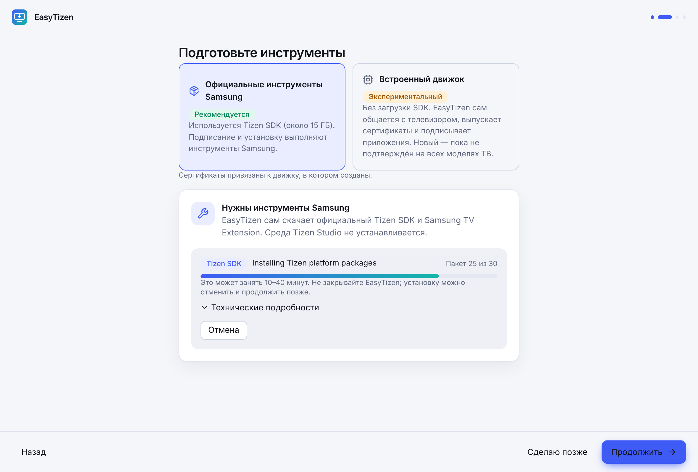<br><sub><b>Подготовка SDK.</b> Выбор способа работы и установка инструментов Samsung с прогрессом и отменой</sub></td>
<td width="50%">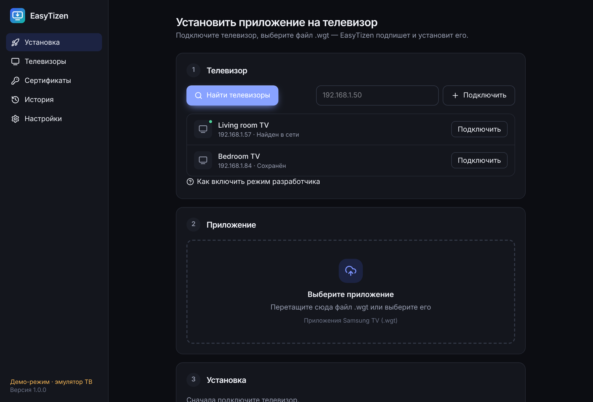<br><sub><b>Подключение телевизора.</b> Поиск в сети, ввод адреса и сохранённые устройства</sub></td>
</tr>
<tr>
<td>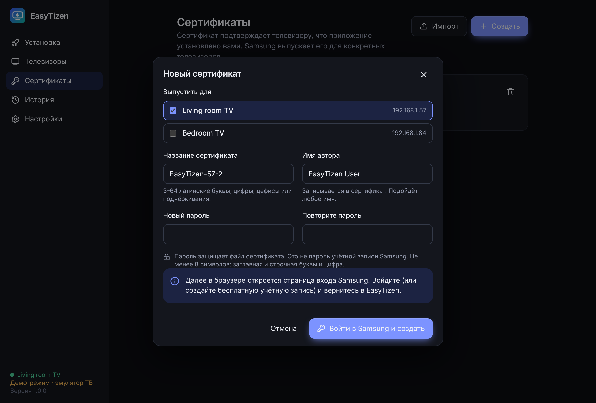<br><sub><b>Сертификат.</b> Выберите телевизоры, придумайте пароль — дальше вход в Samsung в браузере</sub></td>
<td><br><sub><b>Выбор WGT.</b> Сведения о приложении, результат проверки и состояние подписи</sub></td>
</tr>
<tr>
<td>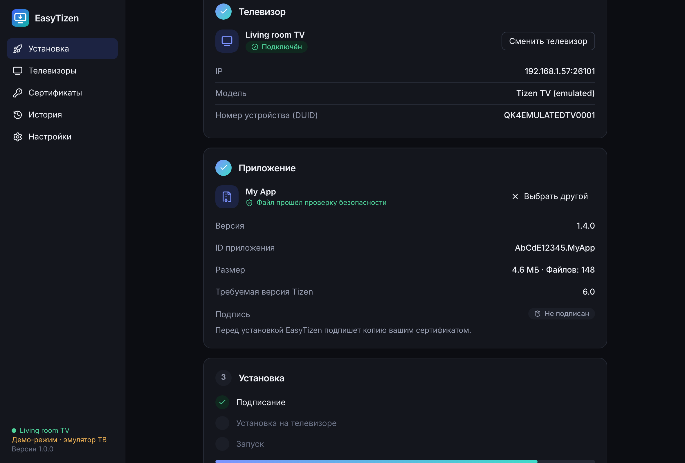<br><sub><b>Установка.</b> Этапы: подписание, подключение, передача, установка, запуск</sub></td>
<td>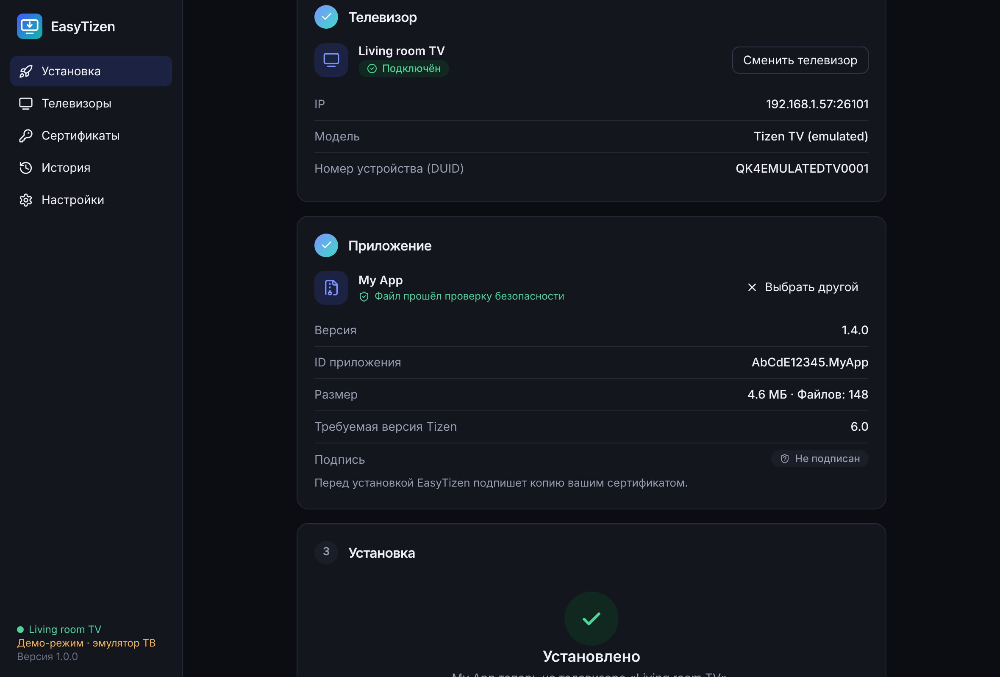<br><sub><b>Готово.</b> Приложение установлено и запущено на телевизоре</sub></td>
</tr>
<tr>
<td>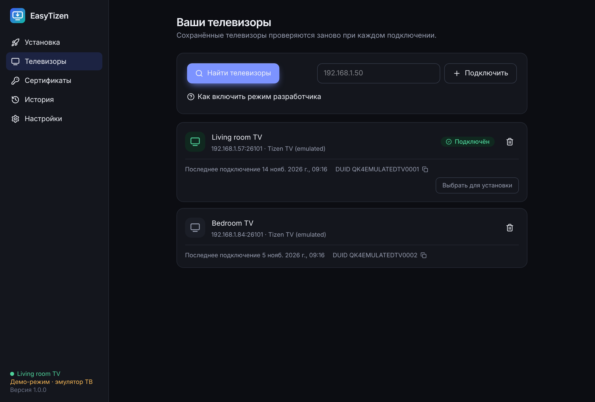<br><sub><b>Телевизоры.</b> Имена, адреса, DUID и время последнего подключения</sub></td>
<td>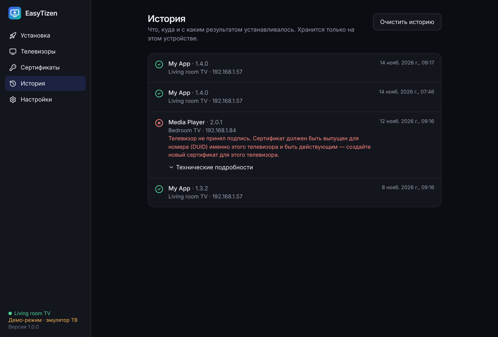<br><sub><b>История.</b> Результаты установок с объяснением ошибок</sub></td>
</tr>
</table>

### На Android

<table>
<tr>
<td width="25%">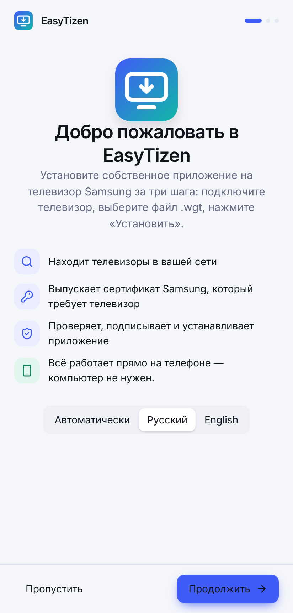<br><sub><b>Первый запуск</b></sub></td>
<td width="25%">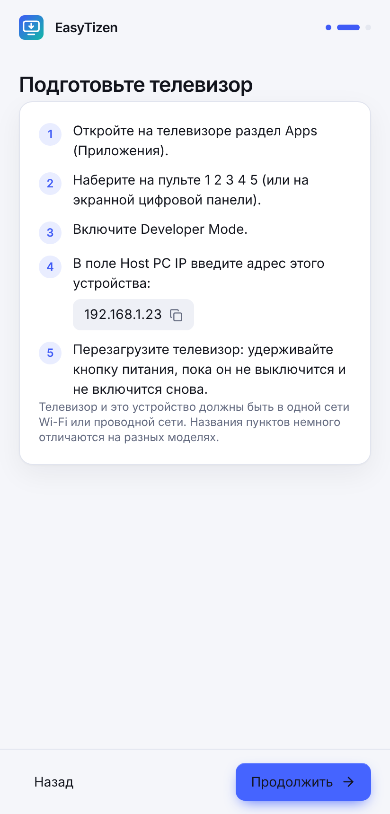<br><sub><b>Подсказка для ТВ</b> с адресом телефона</sub></td>
<td width="25%">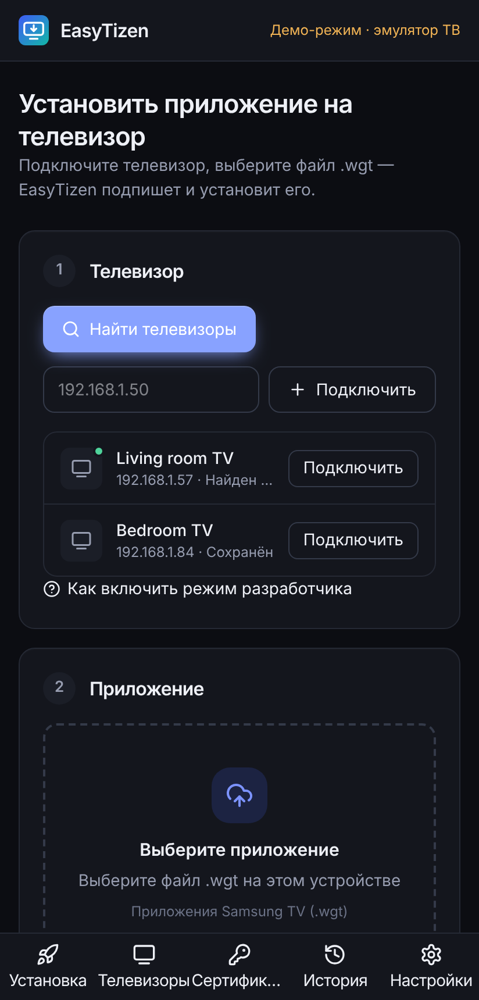<br><sub><b>Поиск телевизора</b></sub></td>
<td width="25%">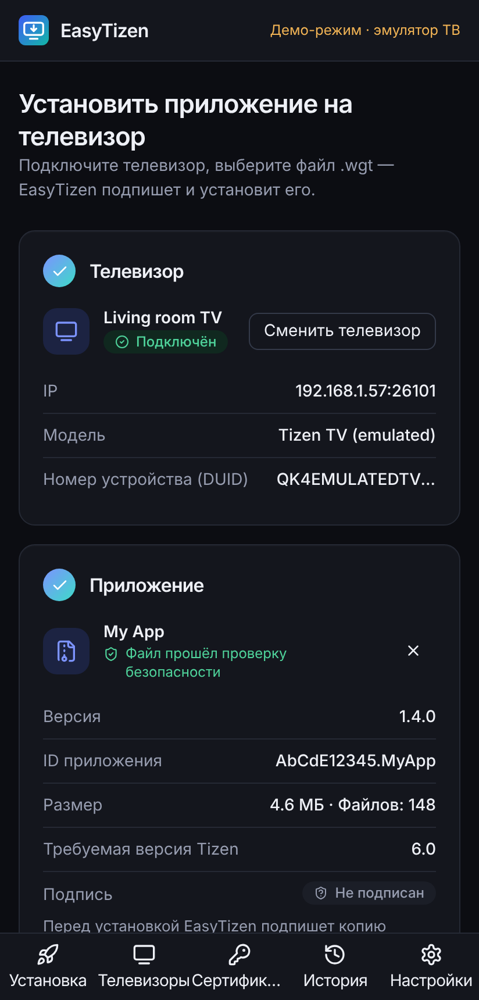<br><sub><b>Файл проверен</b></sub></td>
</tr>
<tr>
<td>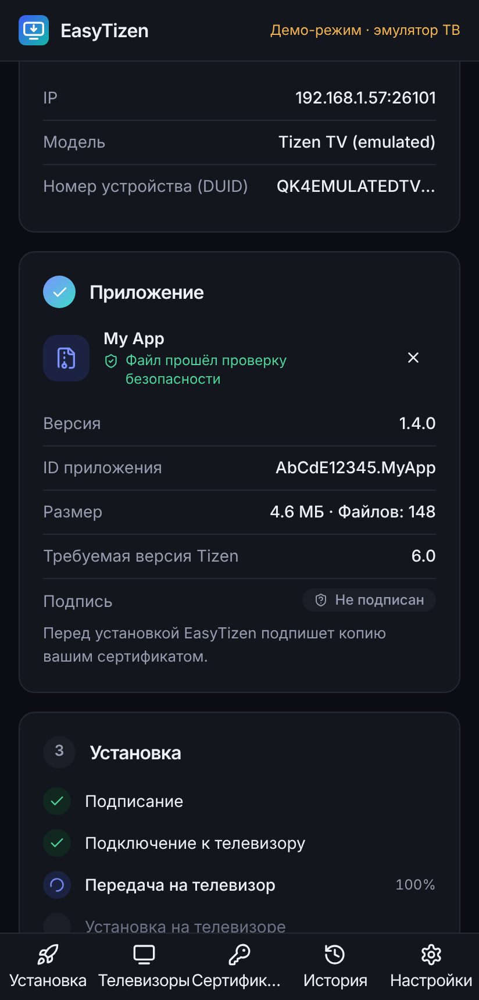<br><sub><b>Ход установки</b></sub></td>
<td>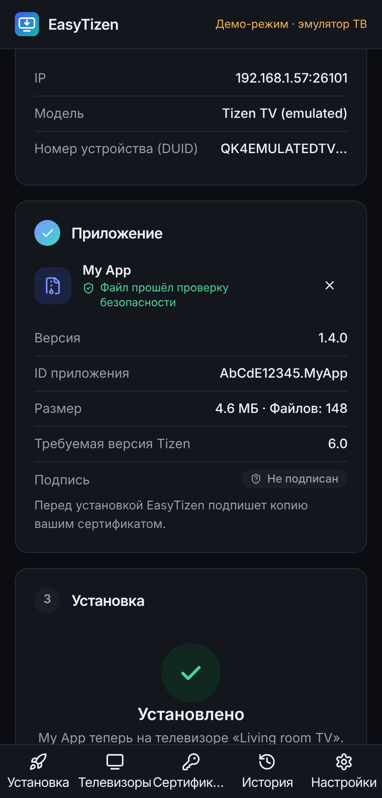<br><sub><b>Установлено</b></sub></td>
<td>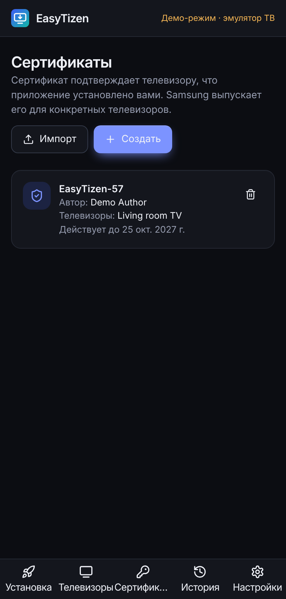<br><sub><b>Сертификаты</b></sub></td>
<td>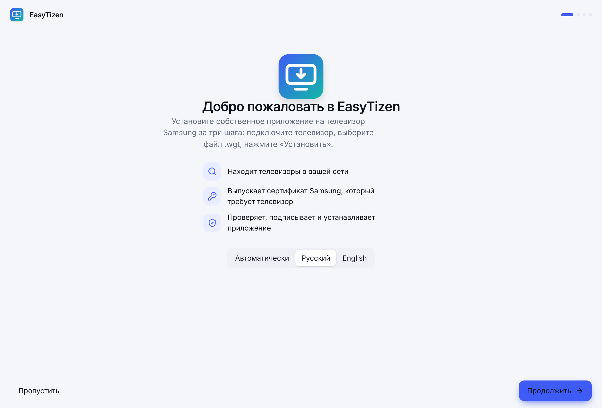<br><sub><b>Светлая тема</b> (компьютер)</sub></td>
</tr>
</table>

<sub>О скриншотах: это настоящий интерфейс EasyTizen, снятый автоматически (<code>scripts/screenshots.mjs</code>) в демонстрационном режиме — телевизор, сертификат и приложение <i>My App</i> на них эмулированы, подпись «Демо-режим» видна на экране. Снимки сделаны в окне браузера с размерами настольного окна и экрана телефона; на реальном телефоне и телевизоре приложение пока не снималось. Окно упакованного приложения для Linux, запущенного в тестовом окружении: <a href="docs/img/linux-window.png">linux-window.png</a>.</sub>

<p align="center"></p>

<a name="install"></a>

##  Установка

Сначала поставьте EasyTizen на своё устройство, затем подготовьте телевизор и выполните первую установку.

<table>
<tr>
<td width="50%"><a href="#android"></a></td>
<td width="50%"><a href="#windows"></a></td>
</tr>
<tr>
<td width="50%"><a href="#macos"></a></td>
<td width="50%"><a href="#linux"></a></td>
</tr>
<tr>
<td width="50%"><a href="#samsung-tv"></a></td>
<td width="50%"><a href="#first-install"></a></td>
</tr>
</table>

| | Android | Компьютер |
|---|---|---|
| Что нужно скачать дополнительно | ничего | Tizen SDK, около 15 ГБ (EasyTizen скачает сам) — или ничего, если выбрать встроенный движок |
| Кто подписывает и устанавливает | встроенный движок EasyTizen | официальные инструменты Samsung (по умолчанию) или встроенный движок |
| Учётная запись Samsung | нужна для сертификата | нужна для сертификата |

<a name="android"></a>

###  Android

Телефон или планшет на Android 7.0 и новее. Компьютер не нужен.

1. Скачайте [`EasyTizen-Android.apk`](https://github.com/volnalabs/TV-Deploy/releases/latest/download/EasyTizen-Android.apk) прямо на телефоне.
2. Откройте файл. Если Android спросит про «неизвестные источники» — разрешите установку для браузера или файлового менеджера, из которого открываете файл.
3. Запустите EasyTizen и пройдите приветствие. Телефон должен быть в той же сети Wi-Fi, что и телевизор (не мобильный интернет и не гостевая сеть).

| Разрешение | Зачем |
|---|---|
| Доступ к сети | связь с телевизором в локальной сети и со службой сертификатов Samsung |
| Состояние сети и Wi-Fi | понять, что телефон в сети, прежде чем искать телевизор |

Других разрешений приложение не запрашивает: файл `.wgt` выбирается через системное окно выбора документа.

> [!WARNING]
> Если APK собран без постоянного ключа проекта (это указано в описании релиза), новую версию нельзя поставить поверх старой: Android попросит сначала удалить прежнюю. При удалении приложения его сертификаты удаляются — создайте их заново или импортируйте файлы `.p12`.

<sub><a href="#install">↑ к выбору устройства</a></sub>

<a name="windows"></a>

###  Windows

Windows 10 и 11, 64-bit.

1. Скачайте [`EasyTizen-Windows-x64-Setup.exe`](https://github.com/volnalabs/TV-Deploy/releases/latest/download/EasyTizen-Windows-x64-Setup.exe) и запустите.
2. Установка идёт для текущего пользователя, права администратора не нужны.
3. При первом подключении к телевизору Windows может спросить о доступе к сети — разрешите его для частных сетей.

> [!NOTE]
> Пока установщик не подписан сертификатом издателя, SmartScreen показывает окно «Система Windows защитила ваш компьютер». Нажмите **Подробнее → Выполнить в любом случае**. Подписан ли конкретный выпуск, написано в описании релиза.

<sub><a href="#install">↑ к выбору устройства</a></sub>

<a name="macos"></a>

###  macOS

macOS 10.15 и новее.

1. Скачайте файл под свой процессор (меню Apple → «Об этом Mac»): [Apple M1 и новее](https://github.com/volnalabs/TV-Deploy/releases/latest/download/EasyTizen-macOS-ARM64.dmg) или [Intel](https://github.com/volnalabs/TV-Deploy/releases/latest/download/EasyTizen-macOS-Intel.dmg).
2. Откройте `.dmg` и перетащите EasyTizen в «Программы».
3. **Первый запуск.** Пока приложение не нотаризовано Apple, macOS его заблокирует. Откройте **Системные настройки → Конфиденциальность и безопасность**, прокрутите вниз и нажмите **«Всё равно открыть»** рядом с сообщением об EasyTizen.

Если macOS пишет, что приложение повреждено, выполните в Терминале:

```sh
xattr -cr /Applications/EasyTizen.app
```

> [!IMPORTANT]
> Для режима «Официальные инструменты Samsung» установщику Tizen SDK нужен Bash 4 или новее, а в macOS встроен Bash 3.2. Установите новый: `brew install bash`. Встроенному движку Bash не нужен.

<sub><a href="#install">↑ к выбору устройства</a></sub>

<a name="linux"></a>

###  Linux

64-bit, с WebKitGTK 4.1 (Ubuntu 22.04 и новее, Debian 12, Fedora 38 и новее).

**AppImage — для любого дистрибутива:**

```sh
chmod +x EasyTizen-Linux-x64.AppImage
./EasyTizen-Linux-x64.AppImage
```

Если не запускается на Ubuntu 22.04 и новее — установите `libfuse2`: `sudo apt install libfuse2`.

**DEB — для Debian, Ubuntu, Mint:**

```sh
sudo apt install ./EasyTizen-Linux-x64.deb
```

После этого EasyTizen появится в меню приложений. Удаление: `sudo apt remove easy-tizen`.

<sub><a href="#install">↑ к выбору устройства</a></sub>

<a name="samsung-tv"></a>

###  Телевизор Samsung: режим разработчика

Телевизоры Samsung не ставят приложения с флешки. Приложение не из магазина устанавливается по сети через режим разработчика.

####  Узнайте адрес устройства с EasyTizen

EasyTizen показывает его сам: в приветствии и по ссылке **«Как включить режим разработчика»** в блоке «Телевизор». Это адрес вида `192.168.1.23` — его телевизор будет считать доверенным.

####  Включите Developer Mode

1. На телевизоре откройте раздел **Apps** (Приложения).
2. Наберите на пульте **1 2 3 4 5**. Если на пульте нет цифр — нажмите кнопку **123** и наберите их на экране.
3. Включите **Developer Mode**.
4. В поле **Host PC IP** впишите адрес из шага 1.
5. Нажмите OK.

####  Перезагрузите телевизор

Удерживайте кнопку питания на пульте, пока телевизор не выключится и не включится снова. В разделе Apps появится надпись **Develop mode**.

> [!TIP]
> Адрес телевизора (если поиск его не найдёт): **Настройки → Общие → Сеть → Состояние сети → Настройки IP**.

<details>
<summary><b>Если телевизор не подключается</b></summary>

<br>

| Что происходит | Что проверить |
|---|---|
| Телевизор не находится поиском | Телевизор включён · режим разработчика включён · оба устройства в одной сети, не в гостевой · попробуйте ввести адрес вручную |
| «Телевизор найден, но не принимает подключения» | В Host PC IP указан адрес именно этого устройства · телевизор перезагружен после изменения настроек |
| Раньше работало, теперь нет | У телефона или компьютера сменился адрес в сети — впишите новый в Host PC IP и перезагрузите телевизор |
| Адрес в Host PC IP записывается задом наперёд | На некоторых прошивках с языком справа налево адрес вводится в обратном порядке |
| Брандмауэр | Разрешите EasyTizen исходящие подключения к порту `26101` |

</details>

<sub><a href="#install">↑ к выбору устройства</a></sub>

<a name="first-install"></a>

###  Первая установка приложения

####  Подготовьте инструменты (только компьютер)

При первом запуске выберите способ работы:

| | Официальные инструменты Samsung | Встроенный движок |
|---|---|---|
| Загрузка | Tizen SDK и Samsung TV Extension, около 15 ГБ | ничего |
| Время подготовки | 10–40 минут | сразу |
| Статус | рекомендуется | экспериментальный |

Для официальных инструментов нажмите **«Установить автоматически»**: EasyTizen покажет папку и свободное место, ход установки по пакетам, позволит отменить и позже продолжить. Уже есть Tizen Studio — нажмите **«Указать готовый SDK»**.

На Android этого шага нет.

####  Подключите телевизор

Нажмите **«Найти телевизоры»** или введите адрес и нажмите **«Подключить»**. После подключения EasyTizen покажет модель и номер устройства (DUID) и запомнит телевизор.

####  Выберите файл `.wgt`

Перетащите файл в окно или нажмите **«Выбрать файл»**. EasyTizen проверит архив и покажет название, версию, ID приложения и состояние подписи.

####  Создайте сертификат

Делается один раз для телевизора.

1. В шаге «Установка» нажмите **«Создать сертификат»**.
2. Отметьте телевизоры, для которых он нужен, придумайте название и пароль (не менее 8 символов: заглавная, строчная буква и цифра). Это пароль файла сертификата, а не учётной записи Samsung.
3. Нажмите **«Войти в Samsung и создать»** — откроется страница входа Samsung в браузере. Войдите или создайте бесплатную учётную запись и вернитесь в EasyTizen.

> [!NOTE]
> Уже есть пара сертификатов из Tizen Studio? Нажмите **«Импортировать готовый»** и укажите `author.p12`, `distributor.p12` и пароли. Сертификат дистрибьютора должен быть выпущен для DUID вашего телевизора.

####  Установите

Нажмите **«Установить на телевизор»**. EasyTizen подпишет копию файла, передаст её и покажет каждый этап. Приложение появится в разделе Apps на телевизоре и, если включено «Запустить после установки», сразу откроется.

<details>
<summary><b>Если установка завершилась ошибкой</b></summary>

<br>

| Сообщение | Что делать |
|---|---|
| Телевизор не принял подпись | Сертификат выпущен для другого телевизора или истёк. Создайте новый сертификат для этого ТВ |
| Приложение подписано другим автором | На ТВ уже стоит это приложение с чужой подписью. Удалите его с телевизора (во встроенном движке — кнопкой «Удалить старую копию…») и повторите |
| На телевизоре недостаточно места | Удалите ненужные приложения на телевизоре |
| Телевизор перестал отвечать | Проверьте сеть, не ушёл ли телевизор в режим ожидания, и повторите |
| Телевизор не подтвердил установку | Проверьте раздел Apps; откройте «Технические подробности» и приложите их к сообщению об ошибке |

Полный текст ответа телевизора доступен под ошибкой в «Технических подробностях» и в разделе «История».

</details>

<sub><a href="#install">↑ к выбору устройства</a></sub>

<p align="center"></p>

<a name="faq"></a>

##  Вопросы и ответы

<details>
<summary><b>Какие телевизоры поддерживаются?</b></summary>

<br>

Телевизоры Samsung на Tizen с режимом разработчика — это модели примерно с 2016 года. Телевизоры Samsung на других системах (Orsay, до 2015 года) и телевизоры других марок не поддерживаются. Список моделей, проверенных с EasyTizen, появится в [отчёте о тестировании](docs/TEST-REPORT.md) — сейчас он пуст.

</details>

<details>
<summary><b>Как включить Developer Mode?</b></summary>

<br>

Apps → наберите на пульте **1 2 3 4 5** → включите Developer Mode → впишите в Host PC IP адрес устройства с EasyTizen → перезагрузите телевизор. Подробно — в разделе [Samsung TV](#samsung-tv); та же инструкция с вашим адресом есть в самом приложении.

</details>

<details>
<summary><b>Почему телевизор не находится?</b></summary>

<br>

Поиск проверяет адреса вашей подсети (`192.168.x.1–254`) на открытый порт разработчика `26101`. Телевизор не найдётся, если выключен режим разработчика, телевизор в глубоком режиме ожидания, устройства в разных сетях (гостевой Wi-Fi, изоляция клиентов, VPN) или сеть крупнее одной подсети /24. В таких случаях введите адрес телевизора вручную.

</details>

<details>
<summary><b>Почему нужен Host PC IP?</b></summary>

<br>

Телевизор принимает подключения разработчика только с одного адреса, который вы сами указали в окне Developer Mode. Это его защита: посторонние устройства в сети не смогут ничего установить. Поэтому при смене адреса телефона или компьютера Host PC IP нужно обновить и перезагрузить телевизор.

</details>

<details>
<summary><b>Что такое DUID?</b></summary>

<br>

Device Unique ID — уникальный номер телевизора. Samsung вписывает его в сертификат дистрибьютора, и телевизор принимает только пакеты, в сертификате которых есть его номер. EasyTizen читает DUID сам при подключении.

</details>

<details>
<summary><b>Зачем нужны сертификаты?</b></summary>

<br>

Tizen устанавливает только подписанные приложения. Нужны два сертификата: **автора** (кто собрал пакет) и **дистрибьютора** (на каких телевизорах его можно запускать). Оба бесплатно выпускает Samsung для вашей учётной записи. Закрытые ключи создаются на вашем устройстве и никуда не отправляются.

</details>

<details>
<summary><b>Почему сертификат привязан к телевизору?</b></summary>

<br>

Так Samsung ограничивает установку приложений не из магазина: сертификат дистрибьютора действует только на телевизорах, чьи DUID в него вписаны. Для нового телевизора создайте новый сертификат — или сразу отметьте в окне создания несколько телевизоров.

</details>

<details>
<summary><b>Какие WGT можно установить?</b></summary>

<br>

Веб-приложения Tizen в формате `.wgt` (ZIP-архив с `config.xml`) размером до 512 МБ. Подписан файл или нет — неважно: EasyTizen подпишет копию вашим сертификатом. Форматы `.tpk` и приложения для других платформ не поддерживаются. Будет ли приложение работать, зависит от версии Tizen вашего телевизора — требуемая версия показана в сведениях о файле.

</details>

<details>
<summary><b>Почему установка завершилась ошибкой?</b></summary>

<br>

Чаще всего — из-за сертификата (выпущен для другого телевизора или истёк), конфликта с уже установленной копией от другого автора или потери связи. EasyTizen показывает причину обычным языком, а полный ответ телевизора — в «Технических подробностях». Таблица решений — в разделе [«Первая установка»](#first-install).

</details>

<details>
<summary><b>Можно ли устанавливать приложения прямо с Android?</b></summary>

<br>

Да, версия для Android — самостоятельный установщик: она сама общается с телевизором по протоколу SDB, выпускает сертификаты и подписывает пакеты. Важная оговорка: эта версия пока проверена автоматическими тестами и сборкой, но не на реальном телефоне с реальным телевизором — см. [ограничения](docs/KNOWN-LIMITATIONS.md).

</details>

<details>
<summary><b>Нужен ли компьютер?</b></summary>

<br>

Нет, если у вас Android. Версии для Windows, macOS и Linux — альтернатива для тех, кому удобнее с компьютера или кто хочет использовать официальные инструменты Samsung.

</details>

<details>
<summary><b>Где хранятся сертификаты?</b></summary>

<br>

- **Встроенный движок:** в папке данных приложения, `certificates/<название>/author.p12` и `distributor.p12`, зашифрованные вашим паролем. Пароль не сохраняется — EasyTizen помнит его до закрытия и спрашивает снова после перезапуска.
- **Официальные инструменты Samsung:** в хранилище Tizen SDK (`<папка SDK>-data/keystore/samsung/<название>/`), пароль хранит защищённое хранилище операционной системы — так устроены инструменты Samsung.

Папка данных: Windows — `%APPDATA%\io.github.volnalabs.easytizen`, macOS — `~/Library/Application Support/io.github.volnalabs.easytizen`, Linux — `~/.local/share/io.github.volnalabs.easytizen`, Android — внутреннее хранилище приложения, недоступное другим приложениям.

</details>

<details>
<summary><b>Как обновляется EasyTizen?</b></summary>

<br>

При запуске приложение спрашивает у GitHub номер последней версии и, если она новее, показывает полосу со ссылкой на установщик для вашей системы. Скачивание и установку вы запускаете сами — тихого автообновления нет. Проверку можно отключить в настройках, там же кнопка «Проверить сейчас».

</details>

<details>
<summary><b>Как диагностировать проблемы?</b></summary>

<br>

**Настройки → Диагностика → «Скопировать отчёт»** (или «Сохранить в файл»). В отчёте — версия, система, состояние инструментов, сохранённые телевизоры, сертификаты и последние установки с ошибками. Паролей, ключей и токенов в нём нет, номера устройств сокращены. Приложите отчёт к [сообщению об ошибке](https://github.com/volnalabs/TV-Deploy/issues).

</details>

<details>
<summary><b>Я пользовался TV Deploy. Что с моими данными?</b></summary>

<br>

EasyTizen — новое имя TV Deploy. При первом запуске он сам переносит настройки, сохранённые телевизоры и профили сертификатов. Tizen SDK и его сертификаты остаются на месте. Старое приложение TV Deploy можно удалить.

</details>

<p align="center"></p>

<a name="dev"></a>

##  Для разработчиков

<details>
<summary><b>Архитектура, структура, тесты и сборка</b></summary>

<br>

```
React/TS интерфейс ──типизированные команды──▶ src-tauri (Rust) ──▶ easytizen-core
                                                    │
                    ┌───────────────────────────────┴──────────────────────────────┐
              SDK-движок (компьютер)                                   Встроенный движок (везде)
        Node.js + Samsung CLI + Tizen SDK                    собственные SDB-клиент, подпись WGT,
              sdb · tz · cert-manager                              выпуск сертификатов Samsung CA
```

```
crates/easytizen-core/   ядро без зависимости от UI: проверка WGT, SDB-клиент, подписание,
                         Samsung CA, диагностика, эмулятор телевизора для тестов
src-tauri/               оболочка Tauri 2: команды, два движка, настройки, история
src-tauri/gen/android/   проект Android (Gradle)
src/                     интерфейс (React, TypeScript, Tailwind), демо-бэкенд для браузера
resources/samsung-cli/   закреплённая копия Samsung tizen-sdk-skills (Apache-2.0)
scripts/                 загрузка Node.js, релизные проверки, генерация картинок README
docs/                    документация, скриншоты, оформление README
```

Нужны Node.js 22 и Rust stable; для компьютера — [зависимости Tauri](https://v2.tauri.app/start/prerequisites/), для Android — JDK 21, Android SDK (platform 36, build-tools 35) и NDK 27.

```sh
npm ci

# Тесты
cargo test --workspace --features easytizen-core/mock-tv   # Rust: ядро и бэкенд
npm test                                                   # интерфейс и релизные скрипты
npm run typecheck

# Интерфейс в браузере с эмулятором ТВ (без Rust)
npm run dev            # http://localhost:1420 · ?platform=android · ?demo=fresh

# Эмулятор телевизора для встроенного движка
cargo run -p easytizen-core --example mock_tv --features mock-tv -- 0.0.0.0 26101

# Компьютер
node scripts/fetch-node.mjs linux-x64     # win-x64 | darwin-arm64 | darwin-x64
npx tauri dev
npx tauri build --bundles appimage,deb    # nsis | dmg

# Android
export ANDROID_HOME=… NDK_HOME=$ANDROID_HOME/ndk/27.2.12479018
npx tauri android build --apk --target aarch64 armv7
```

Подробнее: [архитектура](docs/ARCHITECTURE.md) · [отчёт о тестировании](docs/TEST-REPORT.md) · [ограничения](docs/KNOWN-LIMITATIONS.md) · [выпуск релизов и подпись](docs/RELEASING.md) · [зависимости](docs/DEPENDENCIES.md) · [история изменений](CHANGELOG.md).

</details>

<a name="privacy"></a>
<a name="license"></a>

##  Лицензия и конфиденциальность

**Лицензия.** [Apache-2.0](LICENSE). EasyTizen — независимый проект; он не связан с Samsung и не одобрен ею. Samsung и Tizen — товарные знаки их владельцев.

**Сторонние компоненты**

| Компонент | Где используется | Лицензия |
|---|---|---|
| [Samsung tizen-sdk-skills](https://github.com/Samsung/tizen-agent-skills) (CLI и сертификаты Samsung VD CA) | версии для компьютера; сертификаты CA — везде | Apache-2.0, см. [`LICENSE`](resources/samsung-cli/LICENSE) и [`NOTICE`](resources/samsung-cli/NOTICE) |
| [Node.js](https://nodejs.org/) 22 | версии для компьютера (запуск Samsung CLI) | MIT |
| [Tauri](https://tauri.app/) 2 и плагины dialog, fs, opener | оболочка приложения | MIT / Apache-2.0 |
| [React](https://react.dev/), [lucide](https://lucide.dev/), [Tailwind CSS](https://tailwindcss.com/) | интерфейс | MIT / ISC |
| RustCrypto (`rsa`, `sha2`, `x509-cert`), `p12-keystore`, `ureq`, `rustls`, `zip`, `roxmltree` | ядро | MIT / Apache-2.0 |

Tizen SDK в поставку не входит: при выборе официальных инструментов его скачивает установщик Samsung с серверов Tizen на условиях Samsung. Полный список — в [docs/DEPENDENCIES.md](docs/DEPENDENCIES.md).

**Что хранится на устройстве.** Настройки, список телевизоров (адрес, имя, DUID), сведения о сертификатах, история установок — в папке данных приложения. Сертификаты — зашифрованными файлами `.p12`. EasyTizen не записывает на диск пароли сертификатов и токен Samsung. В режиме официальных инструментов пароль сертификата сохраняют сами инструменты Samsung — в защищённом хранилище операционной системы.

**Куда обращается приложение**

| Адрес | Когда | Что передаётся |
|---|---|---|
| Ваш телевизор, порт `26101`, локальная сеть | поиск, подключение, установка | команды SDB и ваш пакет |
| Адреса вашей подсети, порт `26101` | только при нажатии «Найти телевизоры» | попытка TCP-подключения |
| `account.samsung.com` (в вашем браузере) | создание сертификата | вход выполняете вы сами на сайте Samsung |
| `svdca.samsungqbe.com` | создание сертификата | запрос на сертификат (открытый ключ, имя автора, DUID) и токен Samsung |
| `api.github.com` | проверка обновлений (отключается) | ничего, кроме стандартного запроса |
| `download.tizen.org` и зеркала | установка Tizen SDK (компьютер) | выполняет установщик Samsung |

Собственных серверов, аналитики и телеметрии у EasyTizen нет.
